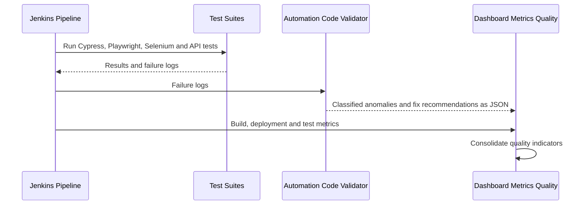

# 📊 Dashboard Metrics Quality: QA & Deployment Metrics for CI/CD Pipelines

### A Unified Quality Dashboard for Deployments, Test Suites and AI-Assisted Failure Analysis

**Dashboard Metrics Quality** consolidates quality data that is usually scattered across tools: **Jenkins pipeline and deployment data**, **test results from Cypress, Playwright, Selenium and API suites**, and **failure classifications from the Automation Code Validator** (an AI agent built with LangGraph and Ollama). The goal is to turn that telemetry into business-ready indicators about the **deployment process and the quality of each release**.

It is the **analytics layer** of a larger CI/CD ecosystem built around [docker-test-env](https://github.com/acorvello/docker-test-env).

> **Status:** 🚧 In development. The sections below describe the target design. Features are marked ✅ available, 🚧 in progress or 💡 planned.

---

## 🗺️ Quick Navigation

* [What It Will Show](#-what-it-will-show)
* [Architecture](#-architecture)
* [Data Sources](#-data-sources)
* [Planned Data Flow](#-planned-data-flow)
* [Design Goals](#-design-goals)
* [Tech Stack](#%EF%B8%8F-tech-stack)
* [Roadmap](#-roadmap)
* [Related Projects](#-related-projects)

---

## 📈 What It Will Show

| Area | Planned indicators | Status |
| :--- | :--- | :---: |
| **Deployments** | Deployment frequency, success and failure rate, build duration trends | 💡 |
| **Test health** | Pass rate per suite and framework, execution time, failure trends | 💡 |
| **Flakiness and failure causes** | Distribution of failure classifications (for example ambiguous or flaky selectors, infrastructure errors) from the code validator | 💡 |
| **Code quality** | SonarQube Quality Gate status per build | 💡 |
| **Release quality overview** | One consolidated health view per pipeline run | 💡 |

---

## 🧭 Architecture

```mermaid
flowchart LR
    subgraph SRC ["Data Sources"]
        direction TB
        JK["Jenkins Pipeline<br/>Builds and Deployments"]
        TS["Test Suites<br/>Cypress, Playwright, Selenium, API"]
        ACV["Automation Code Validator<br/>LangGraph and Ollama"]
        SQ["SonarQube<br/>Quality Gates"]
    end

    SRC --> ING["Ingestion Layer"]
    ING --> ST["Metrics Store"]
    ST --> DASH["Dashboard Metrics Quality<br/>this repository"]
    DASH -.->|"Consolidated telemetry"| PRED["Software Error<br/>Prediction Model"]

    style DASH fill:#1f2d3d,stroke:#38bdf8,stroke-width:2px
    style ING fill:#111827,stroke:#10b981,stroke-width:1px,stroke-dasharray: 5 5
    style ST fill:#111827,stroke:#10b981,stroke-width:1px,stroke-dasharray: 5 5
    style PRED fill:#111827,stroke:#10b981,stroke-width:1px,stroke-dasharray: 5 5
```

Dashed elements are planned.

---

## 🔌 Data Sources

| Source | What it provides | Repository |
| :--- | :--- | :--- |
| **Jenkins** | Build, deployment and stage data for each pipeline run | [docker-test-env](https://github.com/acorvello/docker-test-env) |
| **Test suites** | Results and failure logs for UI and API tests | [Cypress](https://github.com/acorvello/e2e-cypress-js), [Playwright](https://github.com/acorvello/e2e-playwright-python), [Selenium](https://github.com/acorvello/e2e-selenium-java), [API](https://github.com/acorvello/api-testing) |
| **Automation Code Validator** | Classified anomalies and fix recommendations as JSON summaries | [Automation Code Validator](https://github.com/acorvello/REPLACE-WITH-REPO-NAME) |
| **SonarQube** | Static analysis and Quality Gate results | [docker-test-env](https://github.com/acorvello/docker-test-env) |

---

## 🔄 Planned Data Flow

---

## 🎯 Design Goals

* **Single view of quality:** deployments, test results and AI failure analysis in one place.
* **Tool-agnostic ingestion:** results arrive through simple, documented inputs, so new suites can be added without changing the dashboard.
* **Privacy-first:** data stays in your own environment, consistent with the local-LLM approach of the Automation Code Validator.
* **Reproducible setup:** runs alongside the existing Docker Compose environment.

---

## 🛠️ Tech Stack

* **Language:** Python
* **Dashboard UI:** Streamlit
* **Metrics store:** to be defined as the project evolves

---

## 🛣️ Roadmap

- [ ] Define the metrics data model
- [ ] Ingest JUnit XML and test results from the Jenkins pipeline
- [ ] Ingest the Automation Code Validator JSON summaries
- [ ] First Streamlit views: failure rate, execution time and trend
- [ ] Failure classification views from the Automation Code Validator
- [ ] Deployment metrics: frequency, success rate and duration
- [ ] SonarQube Quality Gate indicators
- [ ] Export consolidated telemetry to the Software Error Prediction model
- [ ] Docker Compose integration with `docker-test-env`

---

## 🔗 Related Projects

* [docker-test-env](https://github.com/acorvello/docker-test-env): Docker Compose + Jenkins + SonarQube orchestration
* [Automation Code Validator](https://github.com/acorvello/REPLACE-WITH-REPO-NAME): AI log analysis with LangGraph and Ollama
* [e2e-cypress-js](https://github.com/acorvello/e2e-cypress-js): Cypress E2E suite
* [e2e-playwright-python](https://github.com/acorvello/e2e-playwright-python): Playwright E2E suite
* [e2e-selenium-java](https://github.com/acorvello/e2e-selenium-java): Selenium 4 + JUnit 5 suite
* [api-testing](https://github.com/acorvello/api-testing): REST API tests with Pytest
* [Profile & ecosystem overview](https://github.com/acorvello)

---

## 👤 Author

**Alexsander Corvello da Silveira**, Senior QA Engineer focused on AI-driven testing and applied machine learning.
GitHub: [@acorvello](https://github.com/acorvello)
